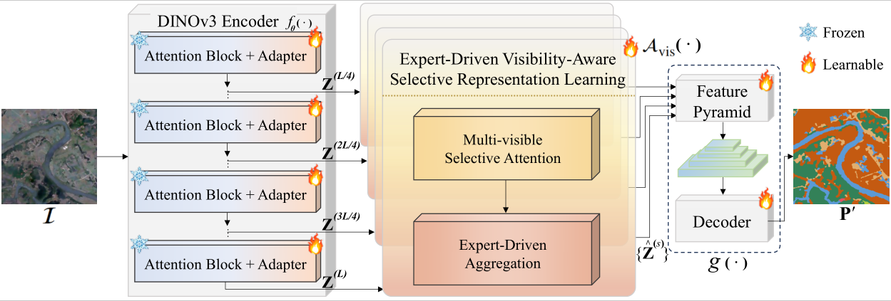

# [IEEE TIP 2026] EVSR

This repo is the official implementation of ['EVSR: Expert-Driven Visibility-Aware Selective Representation Learning from Foundation Vision Models for Remote Sensing Semantic Segmentation'](https://ieeexplore.ieee.org/document/11780711).



## Usage

Train the model by: python train_dino.py

Please cite our paper if you find it is useful for your research.

```
@ARTICLE{EVSR,
  author={Ma, Xianping and Xie, Wanxin and Yu, Weikang and Zhang, Xiaokang and Ye, Yuanxin},
  journal={IEEE Transactions on Image Processing}, 
  title={EVSR: Expert-Driven Visibility-Aware Selective Representation Learning from Foundation Vision Models for Remote Sensing Semantic Segmentation}, 
  year={2026},
  volume={},
  number={},
  pages={1-16},
}
  ```
